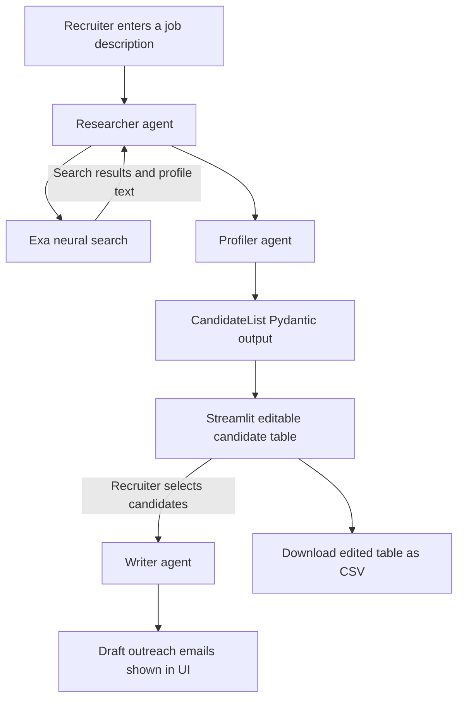

# TalentFlow AI

TalentFlow AI is a Streamlit application that uses CrewAI agents to search for candidate profiles, return structured candidate data, let a recruiter review and edit the results, and draft outreach emails for selected candidates.

## How it works



The Streamlit app runs two separate CrewAI crews. The first uses a researcher with the `find_candidates` Exa tool and a profiler that returns a `CandidateList`. The second creates a writer agent only after the recruiter selects candidates and clicks **Write Emails**. The app keeps the search results and email state in Streamlit session state.

## Agents and data

| Component | Behavior in the repository |
| --- | --- |
| Researcher | Uses `find_candidates` to search Exa for personal profile results; the agent prompt instructs it to use returned profiles and not invent people. |
| Profiler | Scores candidate fit and returns structured output using `CandidateList`. |
| Writer | Drafts outreach text for the candidate rows selected in the UI. |
| Candidate fields | `name`, `profile_url`, `skills`, `score`, and `reasoning`. |
| Search tool | Exa neural search, `category="personal"`, up to five results per tool call, with text content enabled. |
| LLM configuration | CrewAI `LLM` configured for `openai/gemini-3-flash-preview` through Google's OpenAI-compatible API endpoint. |

The task prompts currently contain fixed search and profiling criteria: Bhopal first, then remote; Python, FastAPI, Docker, and LangChain. The entered job description is passed to sourcing, but those criteria are also explicitly embedded in the task instructions. The Pydantic model describes scores as 0–10 but does not define numeric bounds.

## Project structure

```text
TalentFlow-AI/
├── src/
│   ├── agents.py   # CrewAI agent definitions and Gemini configuration
│   ├── app.py      # Streamlit user interface and staged workflow
│   ├── main.py     # Standalone sequential CrewAI workflow
│   ├── models.py   # Candidate and CandidateList Pydantic models
│   ├── tasks.py    # Sourcing, profiling, and writing task prompts
│   └── tools.py    # Exa candidate search tool
├── Dockerfile
├── requirements.txt
├── architecture_diagram.drawio.png
├── .dockerignore
└── .gitignore
```

## Setup

The project uses Python 3.10 in its Docker base image. The dependencies in `requirements.txt` are not version-pinned.

1. Clone the repository and enter it:

   ```bash
   git clone https://github.com/sharma-piyush1/TalentFlow-AI.git
   cd TalentFlow-AI
   ```

2. Create and activate a virtual environment:

   ```bash
   python -m venv .venv
   ```

   Windows PowerShell:

   ```powershell
   .venv\Scripts\Activate.ps1
   ```

   macOS/Linux:

   ```bash
   source .venv/bin/activate
   ```

3. Install dependencies:

   ```bash
   python -m pip install -r requirements.txt
   ```

4. Create a `.env` file in the repository root:

   ```dotenv
   GOOGLE_API_KEY=your_google_api_key
   EXA_API_KEY=your_exa_api_key
   ```

The code loads these values with `python-dotenv`. The Google key is used for the configured Gemini model; the Exa key is used by the candidate search tool.

## Run the Streamlit application

From the repository root:

```bash
streamlit run src/app.py
```

The existing README lists a hosted Streamlit URL at `https://talentflow-ai.streamlit.app`; its availability and deployment configuration are not verifiable from the source files in this repository.

## Use the application

1. Enter a job description in the sidebar and choose **Find & Score Candidates**.
2. Review the returned rows in the editable table. The table includes a **Select** checkbox column and allows candidate details to be edited.
3. Choose rows and click **Write Emails** to request drafts for the selected candidate data.
4. Use **Download Candidate List (CSV)** to download the current edited table. The CSV includes the table's `Select` column; the code does not filter the download to only selected rows.
5. Review the generated email text displayed in the app. The code does not send emails.

## Standalone workflow

`src/main.py` defines a fixed example job description and runs sourcing, profiling, and writing tasks in one sequential CrewAI crew:

```bash
python src/main.py
```

This path calls the same external services and requires the same API keys. Although the script prints a message saying the result was saved to `candidates_outreach.md`, the current code only prints the Crew result and does not write that file.

## Docker

A Dockerfile is present and builds from `python:3.10-slim`. Its current startup command runs `streamlit run app.py`, but the application file is located at `src/app.py`; there is no root-level `app.py`. As written, the container startup command therefore points to a file that is not in the repository.

After building the image, the Streamlit app can be started by overriding the command to use the actual path:

```bash
docker build -t talentflow-ai .
docker run --rm -p 8501:8501 --env-file .env --entrypoint streamlit talentflow-ai run src/app.py --server.port=8501 --server.address=0.0.0.0
```

## Current behavior and limits

- Candidate search and language-model calls depend on Exa and Google's Gemini-compatible endpoint; provider failures can interrupt a workflow.
- The search tool converts Exa exceptions into an error string for the agent. The UI catches exceptions around the search crew and displays them.
- The app asks agents to find real profiles and score fit, but the repository does not implement independent identity or employment verification.
- Search and profiling instructions include fixed role/location/skill criteria alongside the submitted job description.
- Candidate email drafts are displayed for review; there is no email delivery integration.
- The CSV contains the edited table, including its selection column, rather than only selected rows.
- There is no API service or REST route in this repository; the user interface is Streamlit.
- No automated tests are present in the tracked project tree.
